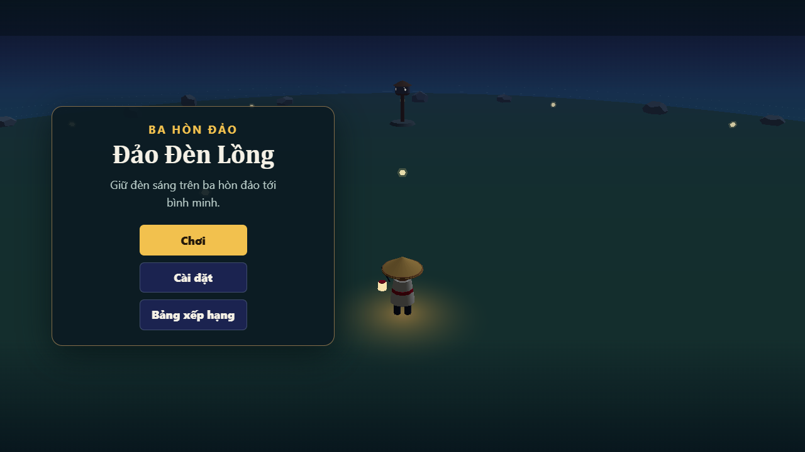

# Day 12 — AI SDLC: Đảo Đèn Lồng

[GitHub Release v1.0.0](https://github.com/IVietDucI/K5-L3A-DAY12-LuuVanVietDuc-2A202603445-AI-SDLC-Dao-Den-Long/releases/tag/v1.0.0) (sau khi phát hành) · [Bằng chứng CP4](docs/proof/phase-4/README.md)

> **Cá nhân** (1 người / 1 MSSV) · Áp dụng SDLC cùng AI để xây một **game 3D** qua **4 phase**, từ yêu cầu ban đầu tới bản phát hành.
> **Lab board + trợ giảng:** **[Đảo Đèn Lồng Lab](https://claude.ai/artifact/Q1RYyv1dxjUczzCbd2ZnoW)**

---

## Chơi Đảo Đèn Lồng v1.0.0

**Lưu Văn Việt Đức · 2A202603445 · L3A**

Mây gom đom đóm, né Bóng Mực và giữ đèn ở ba hòn đảo sáng tới bình minh.



[Kịch bản demo MP4](docs/demo/script.md) · [Hướng dẫn bản Release](docs/release.md) · [Bằng chứng Phase 4](docs/proof/phase-4/README.md)

Cần Node.js 22.12 trở lên, npm và trình duyệt có WebGL 2. Từ bản clone sạch trên Windows, macOS hoặc Linux, chạy:

```sh
npm ci
npm run build
npm start
```

Trình chạy mở `http://127.0.0.1:4173/`. Bấm **Chơi**, rồi **Bắt đầu**. Trên PowerShell, dùng `npm.cmd` nếu hệ thống chặn `npm.ps1`. Dùng `npm run dev` khi sửa mã. Với gói Release đã giải nén, chỉ cần `node scripts/run.mjs`.

| Điều khiển | Hành động |
|---|---|
| WASD hoặc phím mũi tên | Đi theo góc nhìn camera |
| Space | Nhảy |
| Shift | Lướt 12 tick, hồi sau 1,5 giây |
| Kéo chuột trên cảnh | Xoay camera |
| E | Nạp hoặc châm dầu vào đèn gần nhất còn nhận đom đóm trong bán kính XZ 2 m |
| F | Tỏa Sáng |
| Esc hoặc P | Tạm dừng hoặc tiếp tục |

Giữ Mây còn lửa tới bình minh và duy trì số đèn đang sáng theo ngưỡng của từng Đêm.

| Đêm | Thời gian | Đèn cần giữ sáng |
|---|---:|---:|
| Đảo Bến | 04:00 | 3/5 |
| Đảo Cau | 04:30 | 4/6 |
| Đảo Chuông | 05:00 | 5/7 |

Thắp lần đầu cần 10 đom đóm, thắp lại cần 5. Đèn vừa thắp có 100 dầu, hao 1 mỗi giây. Mỗi đom đóm châm thêm 10 dầu tới trần 100. Dưới 30 dầu, đèn chớp và mất vùng an toàn 6 m. Bóng Mực có thể tiến tới đèn yếu và hút thêm 5 dầu/giây mỗi con. **Tỏa Sáng** tốn 3 đom đóm, hồi 3 giây, tác dụng trong bán kính 3D 5 m, ngắt hút dầu, đẩy Bóng Mực 4 m và làm choáng 2 giây.

Gió Lạc có thể cướp 3 đom đóm. Tỏa Sáng xua Gió Lạc hoặc làm nó nhả đồ đã cướp. Bùa Gió cho chạy 7,2 m/s và lướt liên tiếp bằng lần nhấn mới trong 10 giây. Bóng Mực đánh mất một lửa và làm rơi nửa túi. Rơi xuống dưới Y = −10 làm mất một lửa và cả túi, sau đó hồi sinh sau 1 giây nếu còn lửa.

Túi bắt đầu ở 10 ô và tăng 2 mỗi lần thắp, tối đa 20. **Cài đặt** lưu âm lượng, độ nhạy chuột, bảng màu dễ phân biệt, giảm chuyển động, chữ lớn và phím của cả chín hành động. Trò chơi chỉ rõ hướng Bóng Mực mới xuất hiện, báo gió sắp nổi, 10 giây cuối và đèn có dầu dưới 30.

**Điểm.** +5 mỗi đom đóm nạp hoặc châm, +100 lần thắp đầu, +40 lần thắp lại. Tỏa Sáng cho +15 trên mỗi Bóng Mực đang hút dầu hoặc +5 ở trạng thái khác. Khi thắng, thưởng 50 cộng phần nguyên dầu của mỗi đèn đang sáng và 50 mỗi lửa còn. Màn Bình Minh tính tổng điểm các đêm thắng.

Khi thua hoặc tới màn Bình Minh sau Đêm 3, nhập tên dài 3–12 ký tự A–Z, a–z, 0–9 hoặc dấu gạch dưới để lưu tổng điểm. Vào **Bảng xếp hạng** từ menu để xem top 10. Launcher và Vite dùng chung file `~/.dao-den-long/leaderboard.json`. Đặt `DAO_DATA_DIR` để dùng thư mục riêng. Xuất bảng đã lưu bằng `node scripts/run.mjs --export-leaderboard out.json`.

## Kiểm chứng Phase 4

```sh
npm test
npm run build
node docs/proof/phase-3/replay.mjs
```

CLI và giao diện dùng chung simulation 60 tick/giây. CLI nhận `--night 1`, `2` hoặc `3`. Khi tạm dừng, `tick` tăng còn `sim_tick` và dầu đứng yên.

```sh
node src/headless.js --seed 12 --night 1 --scenario docs/proof/phase-3/refuel-shelter.scenario.json --inputs docs/proof/phase-3/refuel-shelter.inputs.json --ticks 31 --out trial.jsonl --snapshot-every 1
```

```sh
node scripts/bench.mjs --seed 42 --duration 30 --out bench.json
node --jitless --expose-gc scripts/soak.mjs --seed 7 --nights 10 --out soak.json
```

Benchmark dùng bản `dist/` đã build, mở cửa sổ Chromium riêng ở 1280×720 và tự thoát sau 3 giây khởi động cộng thời lượng đo. Đặt `DAO_BROWSER` thành đường dẫn Chrome, Edge hoặc Chromium nếu trình chạy không tự tìm được. Dùng cửa sổ thường và GPU thật khi đo theo ticket. `DAO_BENCH_HEADLESS=1` và `DAO_BENCH_SOFTWARE=1` phục vụ chẩn đoán. Chromium nhận cờ `--disable-frame-rate-limit` và `--disable-gpu-vsync`. `peak_mem_mb` là `null` vì phép đo WebGL trong trình duyệt không xác định được peak RSS riêng của cảnh qua API web. [Mã nguồn cờ Chromium](https://chromium.googlesource.com/chromium/src/%2B/6fce3ce354a9abd5a4fd06f558ea5713e29a8d92/components/viz/common/switches.cc).

Kết quả benchmark trong repo được đo trên máy hiện tại (Windows, Intel Core i7-11800H, Intel UHD Graphics, Chrome 157). [Cấu hình và kết quả đo CP4](docs/proof/phase-4/README.md#cấu-hình-đo).

Soak chạy 10 đêm trong cùng tiến trình Node và ghi RSS trước/sau. Tạo lại gói Release sau khi build bằng `npm run package` với lệnh `tar` có sẵn trên hệ điều hành.

[Test Contract v1.3](game.contract.json) · [Changelog](CHANGELOG.md) · [Nguồn và giấy phép](CREDITS.md) · [Retro bốn phase](docs/retro.md) · [ADR](docs/adr/0001-lantern-fuel-and-dawn.md)

## Tài liệu của lab

| File | Nội dung |
|---|---|
| [GUIDE.md](GUIDE.md) | Hướng dẫn làm lab: vòng làm việc mỗi phase, harness, kiểm chứng, token |
| [CHECKPOINTS.md](CHECKPOINTS.md) | Các mốc tự kiểm tra từ chuẩn bị đến nộp bài |
| [SUBMISSION.md](SUBMISSION.md) | Đặt tên repo, hạn nộp, tag, Release, video, checklist |
| [RULES.md](RULES.md) | Quy định: AI, trung thực về bằng chứng, bản quyền, bảo mật |
| [RUBRIC.md](RUBRIC.md) | Thang điểm chi tiết |

## Lab board

Yêu cầu dự án được phát hành tại **[Đảo Đèn Lồng Lab](https://claude.ai/artifact/Q1RYyv1dxjUczzCbd2ZnoW)**. Mỗi phase là một tab (tab chưa phát hành bị khóa), mỗi tab có trợ giảng AI riêng chỉ trả lời trong phạm vi phase đó. Trợ giảng cần đăng nhập claude.ai và dùng lượt Claude của bạn.

## Dự án

**Đảo Đèn Lồng**: game 3D góc nhìn thứ ba. Mây, người giữ đèn nhỏ tuổi, gom đom đóm để thắp lại các Đèn Lồng Lớn và né Bóng Mực trong sương đen.

- Không ràng buộc công nghệ; chạy được trên macOS hoặc Linux.
- Tuân theo **Test Contract** (chế độ headless) để được chấm tự động và so sánh với nhau.

| Phase | Bạn nhận | Nộp |
|---|---|---|
| 1 | **PRD-0** (mô tả tổng quát) + Test Contract | tag `phase-1` |
| 2 | **Ticket-02**, phát hành khi Phase 1 kết thúc | tag `phase-2` |
| 3 | **Ticket-03**, phát hành khi Phase 2 kết thúc | tag `phase-3` |
| 4 | **Ticket-04**, phát hành khi Phase 3 kết thúc | tag `phase-4` + Release `v1.0.0` |

Yêu cầu sẽ được bổ sung và có thể thay đổi giữa các phase, giống dự án thật.

### Lịch 4 giờ

Bài lab kéo dài **4 giờ**. Phase 1 và 2 khoảng **1 giờ**, Phase 3 khoảng **30 phút**, Phase 4 khoảng **1 giờ 30 phút**. Mỗi phase phát hành đúng mốc giờ. Phase mới xuất hiện trên lab board khi tới mốc.

| Mốc | Sự kiện | Hạn tag |
|---|---|---|
| 0h | Phát hành **Phase 1** (PRD-0), gồm cả phần chuẩn bị | `phase-1` trước mốc 1h |
| 1h | Phát hành **Phase 2** | `phase-2` trước mốc 2h |
| 2h | Phát hành **Phase 3** | `phase-3` trước mốc 2h30 |
| 2h30 | Phát hành **Phase 4** | `phase-4`, Release `v1.0.0` và video trước mốc 4h |
| 4h | Hết giờ lab, chốt bài | |

Hết giờ mỗi phase thì tag và chuyển sang phase tiếp theo, dù phase chưa hoàn hảo. Chỗ chưa xong ghi trung thực trong bằng chứng.

---

## Gợi ý SDLC (cách làm là của bạn)

Mỗi phase là một vòng nhỏ. Công cụ, thứ tự, định dạng tài liệu đều tự do; đây chỉ là gợi ý:

1. **Requirements:** biến yêu cầu thành tiêu chí nghiệm thu kiểm chứng được. Chỗ mơ hồ thì tự giả định và ghi lại.
2. **Plan:** nghĩ cách kiểm chứng **trước** khi để agent viết code.
3. **Build:** để agent viết, bạn điều phối và review.
4. **Verify:** chạy thật, kiểm tra hành vi thật. *Không có bằng chứng thì chưa xong*: "agent bảo chạy rồi" không phải bằng chứng.
5. **Evaluate:** cái gì đạt, AI sai ở đâu, harness (AGENTS.md, skill, hook) cần chỉnh gì.
6. **Release:** gắn tag.

## Ba điều cần nhớ

> Bạn được **tự do sáng tạo thêm** quanh phần lõi (nhân vật, cơ chế nhỏ, câu chuyện, hiệu ứng, âm thanh…). Sáng tạo gọn và không phá yêu cầu được tính điểm trong hạng mục F của [RUBRIC](RUBRIC.md); ghi mục "Sáng tạo của tôi" trong README của bạn.

- **Game tốt là game đúng yêu cầu của khách hàng**, không phải game phức tạp hay đẹp nhất. Làm đúng và chứng minh được là đúng trước, trau chuốt sau.
- **Cân nhắc kỹ quota token của bạn.** Đốt nhiều token không làm bài tốt hơn. Ngữ cảnh gọn, kế hoạch rõ, kiểm chứng sớm thường vừa rẻ vừa đúng hơn chạy agent liên tục.
- **Kiểm chứng là phần quan trọng nhất.** Bằng chứng (test, output headless, ảnh, số đo) đáng giá hơn lời mô tả.

---

## Bàn giao cuối cùng

Một **repo GitHub cá nhân, public**, gồm:

1. **Toàn bộ mã nguồn** của game qua 4 phase, tag `phase-1` … `phase-4`, Release `v1.0.0`.
2. **Video demo `.mp4` dưới 5 phút** (đính kèm Release `v1.0.0` hoặc `docs/demo/demo.mp4`, link ở đầu README): chơi thử và cho thấy bằng chứng game chạy đúng.
3. **Bằng chứng kiểm chứng** của từng phase (định dạng tự chọn).
4. **Harness AI đã dùng** (AGENTS.md / CLAUDE.md, skills, hooks, plugins…), giữ nguyên trong repo và lịch sử git.
5. **Ghi chép ngắn:** spec/giả định mỗi phase, nhật ký dùng AI (gồm token/chi phí ước tính), retro.

Không commit API key, token hay `.env`. Gửi link repo theo hướng dẫn của Coach.

## Đánh giá (100 điểm)

| Hạng mục | Điểm |
|---|---|
| Test tự động ẩn (headless, gồm kiểm tra lại phase trước) | 30 |
| Kiểm chứng & bằng chứng của bạn | 20 |
| Quy trình SDLC & harness AI | 15 |
| Evaluation & retro (gồm cách bạn dùng token) | 10 |
| Hiệu năng & ổn định | 10 |
| Chất lượng sản phẩm (đúng yêu cầu, chơi được) | 10 |
| Video demo | 5 |

## Quy định

- Dùng AI thoải mái; không sao chép repo của người khác.
- Bằng chứng phải thật: test luôn đạt hay output sửa tay là vi phạm.
- Nhân vật, bối cảnh là bản gốc của lab; asset bên ngoài chỉ dùng loại CC0/CC-BY/MIT hoặc tự tạo, ghi nguồn trong `CREDITS.md`.
